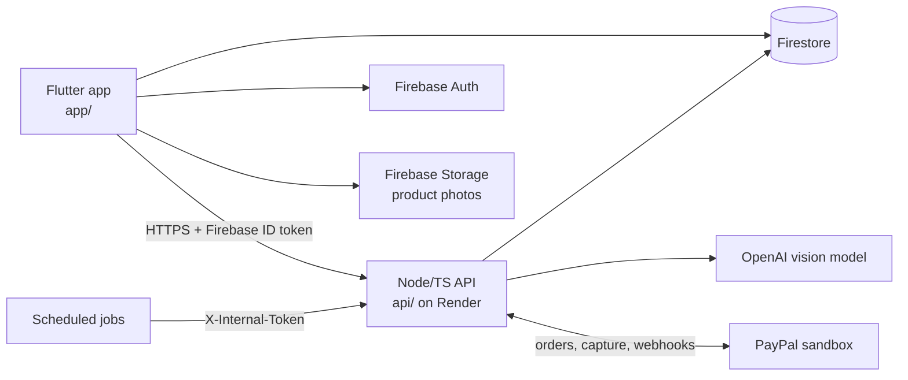

<p align="center">
  
</p>

<h1 align="center">Sorted</h1>

<p align="center">From DM to paid. Sorted.</p>

Small sellers in the UK take orders through Instagram, TikTok and WhatsApp DMs. The order details are scattered across a chat, the seller types up a payment request by hand, and then has to remember who has paid and who to chase.

Sorted turns a screenshot of that chat into a structured order, gives the seller a ready-to-paste reply with a real PayPal payment link, and tracks the payment from there.

## Try it

- **iOS (TestFlight):** TESTFLIGHT_LINK_TBD
- **Demo video:** DEMO_VIDEO_TBD — it walks through the whole flow, from catalogue snap to a paid order, so you can follow it without installing anything.

There is no web build.

## How it uses AI and PayPal

**AI**

- **Catalogue snap.** The seller photographs their products; the API extracts names and prices into a catalogue (`POST /v1/catalogue/extract`), and the photos are saved to Firebase Storage.
- **DM to order.** A DM screenshot is read into a draft order and matched against the catalogue (`POST /v1/orders/draft`). Anything unclear is flagged for the seller to resolve.
- **Reply ready.** Once the seller confirms, Sorted drafts a reply to the buyer that includes the amount and the payment link. The seller copies it into the chat.
- **Nudges.** An unpaid link becomes due a reminder at 24 hours and again at 72 hours (at most two). The seller picks a tone (friendly, gentle or firm), and the AI drafts the reminder. If a draft doesn't pass checks, a plain template is used instead. Sorted never messages the buyer itself.

**PayPal (sandbox)**

- **Orders and capture.** Confirming an order creates a PayPal checkout order (Orders v2). When the buyer approves, the API captures the payment.
- **Webhooks.** `POST /v1/webhooks/paypal` verifies each event with PayPal and applies order approved and capture completed / pending / denied / refunded events.
- **Reconcile.** A scheduled job re-checks open orders with PayPal, so a missed webhook is picked up within about 10 minutes.
- **Cancel and expiry.** The seller can cancel an unpaid order (`POST /v1/orders/:orderId/cancel`), which checks PayPal first. Unpaid links close after `ORDER_EXPIRY_HOURS` (default 168, seven days). A capture that lands on an already-closed order is marked as needing a refund.

## Built with

| Tool | What it does in Sorted |
|---|---|
| **PayPal** (Orders v2, webhooks, sandbox) | Creates the payment link for each order, captures it when the buyer approves, and keeps the order status in step through verified webhooks and the reconcile job |
| **OpenAI** (`gpt-5.5`) | Reads catalogue photos and DM screenshots into structured data, and drafts replies and nudges. All calls use a strict JSON schema with one corrective retry |
| **Render** (sponsor) | Hosts the API as a web service, deployed from `api/render.yaml` as a Blueprint |
| **Flutter** | The seller's iOS app. Uses Riverpod, go_router, flutter_animate and freezed, and receives screenshots from the share sheet |
| **Firebase** | Auth, Firestore (live order status), and Storage (product photos) |
| **Node.js, TypeScript, Express** | The API, with zod validating every request and model response |
| **Vitest, Supertest, Firebase emulators** | API tests run offline against the Firestore and Auth emulators |

## Architecture



| Path | What it is |
|---|---|
| `app/` | Flutter app |
| `api/` | Node + TypeScript (Express) API, deployed on Render via `api/render.yaml` |
| `samples/` | Sample DM screenshots and a seed catalogue (`seed-catalogue.json`) |
| `docs/` | Design spec, plans and notes |
| `firestore.rules`, `storage.rules` | Firebase security rules |
| `scripts/emulators.sh` | Starts the Firestore and Auth emulators for tests |

## Running locally

### API

Needs Node 18+.

```sh
cd api
npm ci
npm run dev        # tsx watch, listens on PORT (default 3000)
```

`npm run build && npm start` runs the compiled build. Health check: `GET /v1/health`.

Environment variables (from `api/render.yaml`; set them in your shell or a `.env` file, never commit values):

| Variable | What it's for |
|---|---|
| `NODE_ENV` | `development`, `test` or `production` |
| `PAYPAL_CLIENT_ID` | PayPal REST app client id |
| `PAYPAL_CLIENT_SECRET` | PayPal REST app secret |
| `PAYPAL_WEBHOOK_ID` | Id of the PayPal webhook, used to verify incoming events |
| `OPENAI_API_KEY` | Key for the AI calls (extraction, replies, nudges) |
| `OPENAI_VISION_MODEL` | Model used for those calls |
| `FIREBASE_PROJECT_ID` | Firebase project the API reads and writes |
| `FIREBASE_SERVICE_ACCOUNT_JSON` | Service-account JSON, on one line, for Firestore admin access |
| `INTERNAL_TOKEN` | Shared secret for the internal workflow endpoints |
| `PUBLIC_BASE_URL` | Origin for the buyer return and cancel pages; defaults to the hosted Render URL |

Optional, not in `render.yaml`: `PORT` (default 3000), `PAYPAL_ENV` (sandbox unless set to `live`), `ORDER_EXPIRY_HOURS` (default 168).

### Internal workflow endpoints

Called by scheduled jobs. Each is a `POST` with the header `X-Internal-Token: <INTERNAL_TOKEN>`.

| Endpoint | Schedule | What it does |
|---|---|---|
| `/v1/internal/workflows/reconcile` | Every 10 minutes | Re-checks open orders with PayPal |
| `/v1/internal/workflows/expire-sweep` | Hourly | Closes unpaid links past `ORDER_EXPIRY_HOURS` |
| `/v1/internal/workflows/nudge-sweep` | Hourly | Pre-drafts reminders for orders that are due one (sends nothing) |

### App

Needs Flutter and a Firebase project configured for the app.

```sh
cd app
flutter pub get
flutter run --dart-define=API_BASE_URL=http://localhost:3000
```

Without `API_BASE_URL` the app talks to the hosted API.

## Tests

API (needs a JDK 21+ and firebase-tools for the emulators):

```sh
cd api
npm run emulators   # in one terminal; runs offline against the demo-sorted project
npm test            # in another
npm run typecheck
```

`*.live.test.ts` suites call the real model and are skipped unless the credentials are set.

App:

```sh
cd app
flutter test
```

## Licence

MIT, an OSI-approved licence. See [LICENSE](LICENSE).
